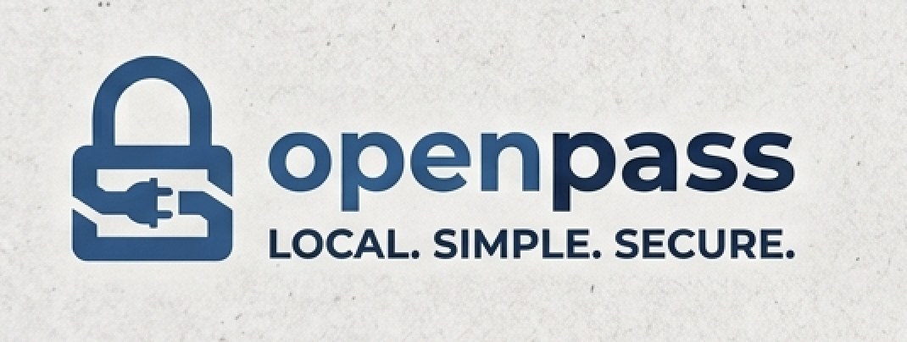

<div align="center">



**A completely local password manager. No sync, no accounts, no network.**

</div>

---

## Fills passwords on sites that fight you

Plenty of login pages block paste. Banks, payroll portals, anything with a
security consultant. You end up reading a 24-character password off another
screen and typing it one character at a time.

openpass fills it in one click.

```
1. click the field you want filled
2. click the openpass icon
3. click  Username  or  Password
```

It also saves new sites: the popup captures what you just typed into a login
form, or generates a password for you.

## Setup

Needs Go 1.27+, and on macOS the Xcode Command Line Tools.

```bash
git clone https://github.com/chetankar65/openpass
cd openpass
./setup.sh
```

That one command builds everything, creates your vault, installs the menu bar
app on macOS, and walks you through loading the browser extension.

Your **master password cannot be recovered**. There is no reset, by design.

## Using it

- **Browser:** click a field, click the openpass icon, pick the entry. Before
  any password is handed over, you're asked to allow it.
- **Menu bar (macOS):** unlock, search, and press Return to copy a password
  (cleared after 30 seconds). **+** adds an entry; ↻ changes a password. It also
  shows the Allow/Deny dialog for browser requests.
- **Terminal:** `openpass get GitHub`, `openpass add GitHub -gen`, `openpass ls`.
  On Linux, keep `openpass watch` running to answer browser requests.

## How it works

A daemon (`openpassd`) owns an encrypted vault file and exposes a JSON-RPC API
over a Unix socket. The CLI, the menu bar app and the browser extension are all
clients of that API — none has a privileged path to the vault.

```
openpass get github     ─┐
                         ├─▶  openpassd  ──▶  vault.opv
browser extension ──▶ bridge ─┘   (holds the key in memory while unlocked)
```

- **Argon2id** derives a key from your master password, which unwraps the key
  that encrypts the vault with **XChaCha20-Poly1305**.
- The whole vault is one ciphertext, so the file leaks no names, usernames, or URLs.
- The vault auto-locks after 15 minutes idle.

## Limitations

- No master password change, TOTP, import, or Firefox support yet.
- Pairing gives you policy and revocation, not protection from malware running
  as your user. The control it can't get past is you answering the approval prompt.

## Docs

- [docs/CLI.md](docs/CLI.md) — every command, pairing and approvals, files, daemon flags
- [docs/DESIGN.md](docs/DESIGN.md) — threat model, crypto, vault format
- [docs/API.md](docs/API.md) — the daemon's RPC API
- [extension/README.md](extension/README.md) — browser extension

## Contributing

```bash
gofmt -w . && go vet ./... && go test -race ./...
```

Start with [docs/DESIGN.md](docs/DESIGN.md). `internal/crypto` is the package
to read first and change last.
